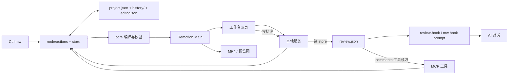

# Media Workspace 项目地图

开工前必读：`AGENTS.md` → `docs/STATUS.md` → 本文档。**已确认**：对应代码基线提交 `12f4b26`，更新于 2026-11-02；本文档提交号以 Git 记录为准。依据：`git rev-parse --short HEAD`、`git status --short`。

**负责人速览**（已确认，依据：`README.md`、`AGENTS.md` §3、§6、§7、`src/node/store.ts`）：

- 项目是本机口播视频工作台：AI 编排，人审片批注，最后导出 MP4。
- 最容易出事的三处：工程格式与操作规则、并发写入与历史、预览和导出画面不一致。
- 每次验收做三件事：查 `docs/STATUS.md` 的任务归属；看实际 `pnpm check`、`pnpm test`（涉及媒体再看 `pnpm test:e2e`）输出；用测试工程看预览并抽查导出帧。

## 一、项目一句话

**已确认**：本机口播视频工作台。AI 通过 CLI（命令行）或 MCP（供 AI 调用的本机工具接口）导入、识音、剪辑、排版；负责人在网页审片、批注，最后导出 MP4。依据：`README.md`、`src/cli/index.ts`、`src/mcp/server.ts`、`src/web/app.tsx`。

## 二、目录地图

| 目录 | 负责什么；改动容易影响哪里 |
|---|---|
| `src/core/` | **已确认**：工程格式、操作、时间换算、校验；影响所有入口和成片。依据：`AGENTS.md` §2、`src/core/schema.ts`、`ops.ts`、`compile.ts`。 |
| `src/node/` | **已确认**：存储、素材、识音、渲染和运行时字体目录；影响数据安全、字体解析和媒体结果。`src/node/fonts.ts` 扫描项目注册字体与本机 `fc-list` 字体，缓存路径只留在进程内。依据：`src/node/store.ts`、`render.ts`、`fonts.ts`。 |
| `src/cli/`、`src/mcp/` | **已确认**：`mw` 命令和 AI 工具；影响参数与返回信息。依据：`src/cli/index.ts`、`src/mcp/server.ts`。 |
| `src/server/`、`src/web/` | **已确认**：本地服务和网页；影响操作、审片、批注。依据：`src/server/app.ts`、`src/web/app.tsx`。 |
| `src/templates/`、`src/composition/` | **已确认**：模板和 Remotion（逐帧合成视频的工具）；影响预览与导出画面。依据：`AGENTS.md` §2、`src/composition/Main.tsx`。 |
| `bin/`、`scripts/`、`tests/` | **已确认**：启动、辅助脚本、测试；影响启动、生成资料、验收。依据：`bin/mw.mjs`、`scripts/align-edit.ts`、`package.json`。 |
| `docs/`、`assets/`、`local/` | **已确认**：公开文档、字体、本地私有笔记；字体影响画面，`local/` 不进 Git。依据：`AGENTS.md` §1、§7、`.gitignore`。 |
| `fixtures/` | **已确认**：当前只有被忽略的 `out/1029/`，含 `edl.json`、`source.srt` 和媒体；`scripts/align-edit.ts` 会生成前两者，决策记录说明 SRT 曾用于时间基准测试。当前 `src/`、`tests/`、`scripts/` 没有直接引用 `fixtures/` 路径。依据：目录实查、`scripts/align-edit.ts`、`docs/decisions/0001-sample-1029-analysis.md`、`.gitignore`、仓库文本检索。 |

## 三、数据在哪里

**已确认**：工程默认在 `~/MediaWorkspace/projects/<名字>.mwproj/`，可用 `MW_HOME` 更改。下表“能否手改”按仓库规则回答。依据：`src/node/paths.ts`、`AGENTS.md` §1、§3。

| 文件 | 存什么 | 谁会写入 | 能否手改 |
|---|---|---|---|
| `project.json` | **已确认**：素材引用、轨道、样式、版本号。依据：`src/core/schema.ts`。 | **已确认**：CLI、MCP、网页均经 `src/node/store.ts` 提交；网页走 `src/server/app.ts`。 | **已确认**：不能直接改，必须走 store。依据：`AGENTS.md` §3、`src/node/store.ts`。 |
| `editor.json` | **已确认**：参考线等编辑状态，不放影响渲染的数据。依据：`src/core/api.ts`、`AGENTS.md` §3。 | **已确认**：网页设置经本地服务调用 `saveEditor`；建工程时写默认值。依据：`src/web/store.ts`、`src/server/app.ts`、`src/node/store.ts`。 | **推测**：应通过界面改；没有明文禁令，手写值可能不合格式。依据：`AGENTS.md` §3、`src/node/store.ts`。 |
| `review.json` | **已确认**：批注和处理状态，不增加工程版本号。依据：`src/core/review.ts`、`src/node/store.ts`。 | **已确认**：网页、CLI/MCP 经 store 批注函数写入。依据：`src/server/app.ts`、`src/cli/index.ts`、`src/mcp/server.ts`。 | **推测**：应走批注入口，手改绕过锁与校验。依据：`src/node/store.ts`。 |
| `history/` | **已确认**：提交前的旧版工程快照供回退，最多保留 200 版。依据：`src/node/store.ts`。 | **已确认**：store 在提交时写入、清理。依据：`src/node/store.ts`。 | **已确认**：不要手改，否则可能破坏回退。依据：`src/node/store.ts` 的 `commit`、`readHistory`。 |

**已确认**：网页与 AI 同时改同一工程时，谁先成功取锁并写入不固定；后到者若携带旧 `baseRevision`，被拒绝为 `CONFLICT`：“工程已经被修改：当前是第 N 版，你基于第 M 版”，并提示重新 `mw inspect` 再提交。网页提示“工程刚被其他地方修改过，已刷新到最新版本，请再操作一次”。被拒绝的操作未写入，先提交的修改不会被覆盖；若等锁超过 5 秒，返回 `CONFLICT` 并提示“稍后重试”。依据：`src/node/store.ts` 的 `withLock`、`checkRevision`、`commit`，`src/web/store.ts` 的 `fail`、`submit`。

**已确认（字体运行时）**：`GET /api/fonts` 返回项目/系统字体的族名、来源、字重、可用性、可导出标记和授权状态；授权状态只从 `docs/font-licenses.md` 的表格解析，系统字体无记录时为“未登记”。默认使用进程缓存，查询参数 `refresh=1` 手动刷新。响应不包含绝对路径，工程样式仍通过 `font.family` 保存旧注册 ID 或 CSS 字族名。依据：`src/node/fonts.ts`、`src/server/app.ts`、`src/core/api.ts`、`docs/font-licenses.md`。

**已确认（网页字体体验）**：`src/web/components/font-warning-modal.tsx` 消费预览 `fontWarnings`，列出受影响字幕/标题，替换通过 `styleEditOps` 支持 item/shared 范围并沿用 undo/redo；“不再提醒”只写 `editor.json` 的 `fontWarningsDismissed`。字体选择器显示项目/系统来源和授权状态，导出完成在 `src/web/components/top-bar.tsx` 汇总 `X→Y`。未知授权只提示，不阻断预览、编辑或导出。

**已确认（实测范围：字幕文本）**：在独立测试工程的网页输入“网页草稿未提交”，保持焦点不失焦；终端用 `mw apply` 将同一句改成“终端已提交”。网页收到更新后，输入框立即变为终端文本；点击外部失焦后工程仍是终端文本、版本号仍为 3。未提交的字幕草稿没有保留，也没有覆盖已提交数据。其他控件是否同样处理仍**未知**。依据：本次临时工程 `/tmp/mw-draft-conflict.dw9cw6/Test.mwproj` 的网页操作与 `mw inspect` 结果、`src/web/components/inspector/caption.tsx` 的状态同步。**已确认**：原始素材只读，生成媒体放 `cache/`。依据：`AGENTS.md` §3、`src/node/paths.ts`。

## 四、三条典型路径

1. **AI 改工程（已确认）**：① `src/cli/index.ts` 或 `src/mcp/server.ts` 接命令；② `src/node/actions.ts` 做导入、识音或剪辑；③ `src/core/ops.ts` 和 `validate.ts` 计算、检查；④ `src/node/store.ts` 加锁、查版本、备份后写 `project.json`。依据：上述文件。
   出问题时先检查哪里：**已确认**：错误码与版本号、`src/node/store.ts`、`history/`。依据：`src/core/errors.ts`、`src/node/store.ts`。
2. **批注往返（已确认）**：① `src/web/` 提交批注；② `src/server/app.ts` → `src/node/store.ts` 写 `review.json`；③ `mw hook prompt` 经 `src/node/review-hook.ts` 把新批注附给 AI，AI 也可用 MCP `comments` 读取；④ AI 改工程并将批注 `resolve`。依据：`src/web/data/client.ts`、`src/cli/index.ts`、`src/mcp/server.ts`。
   出问题时先检查哪里：**已确认**：`review.json` 的未处理状态、`review-hook.ts` 的工程目标/已读记录、`.codex/hooks.json` 或 `.claude/settings.json`。依据：这些文件。
3. **导出 MP4（已确认）**：① CLI/MCP/网页经 `src/node/actions.ts` 请求；② `src/core/compile.ts` 编成逐帧时间线；③ `src/node/render.ts` 准备素材；④ `src/composition/Main.tsx` 与 Remotion 合成。网页预览也用 `Main`，但可用低清代理。依据：`src/server/app.ts`、`src/node/render.ts`、`src/web/components/stage.tsx`。
   出问题时先检查哪里：**已确认**：工程和素材路径、`compile.ts`、`render.ts` 的日志及导出抽帧。依据：`src/node/paths.ts`、`src/node/render.ts`。

## 五、架构图

**已确认**：箭头表示调用或数据方向；批注 hook 在对话提交时把新批注附给 AI。依据：`src/node/review-hook.ts`、`.codex/hooks.json`、`.claude/settings.json`。

## 六、高风险区域

| 文件 | 为什么危险 | 改之前先做什么 | 建议由谁修改 |
|---|---|---|---|
| `src/core/schema.ts`、`migrations/` | **已确认**：格式变化影响旧工程、各入口和渲染。依据：`AGENTS.md` §3、`src/node/store.ts`。 | **已确认**：占行、定新版本、迁移和测试，记决策。依据：`AGENTS.md` §3、§7。 | **已确认（来源：项目负责人）**：GPT Sol 亲自改或指定唯一修改人；DS 审。 |
| `src/core/ops.ts`、`validate.ts`、`compile.ts` | **已确认**：写入规则、合法性和帧时间线共用。依据：`src/node/store.ts`、`src/node/render.ts`。 | **已确认（来源：项目负责人）**：先列调用方、占行、指定唯一修改人。 | **已确认（来源：项目负责人）**：GPT Sol 亲自改或指定唯一修改人；DS 审。 |
| `src/node/store.ts` | **已确认**：锁、版本、历史和原子写入唯一入口。依据：该文件、`AGENTS.md` §3。 | **已确认（来源：项目负责人）**：先审冲突、回退和崩溃路径，指定唯一修改人。 | **已确认（来源：项目负责人）**：GPT Sol 亲自改或指定唯一修改人；DS 审。 |
| `src/node/render.ts`、`src/composition/Main.tsx` | **已确认**：影响预览与导出。依据：`src/node/render.ts`、`src/web/components/stage.tsx`。 | **已确认**：跑 `pnpm check`、`pnpm test`、`pnpm test:e2e`。依据：`AGENTS.md` §6。 | **推测（依据负责人角色和 `AGENTS.md` §2）**：`render.ts` 由 Sol 指定唯一修改人，`Main.tsx` 由 DS；跨文件改动先统一归属并交叉审。 |
| `src/mcp/server.ts`、`src/node/review-hook.ts` | **已确认**：工具契约和批注进 AI 对话的路径。依据：两文件、`src/cli/index.ts`。 | **推测（依据负责人角色和 `AGENTS.md` §2）**：先核对接口与 hook 配置，明确唯一修改人。 | **推测（依据负责人角色和 `AGENTS.md` §2）**：MCP 文案小改可给 Luna；工具契约和 hook 行为由 Sol 亲自改或指定唯一修改人，DS 审。 |

## 七、如何验证改动

**已确认**：命令作用依据 `package.json`、`AGENTS.md` §6；`mw lint` 是画面质检提示，不阻止导出，依据 `src/core/lint.ts`。

| 改动类型 | 至少运行哪些命令 |
|---|---|
| **已确认**：任何代码改动 | `pnpm check`（Biome 与类型）、`pnpm test`（单元测试）；依据：`AGENTS.md` §6、`package.json`。 |
| **已确认**：渲染、媒体、模板 | 上述两项 + `pnpm test:e2e`；依据：`AGENTS.md` §6。 |
| **已确认（来源：项目负责人）**：画面布局或安全区 | 上述适用项 + 测试工程预览、`mw lint <工程>`、导出抽帧；依据：`src/core/lint.ts`、`src/node/render.ts`。 |
| **已确认**：仅改文档 | 无代码测试要求；检查引用并运行 `git diff --check`。依据：`AGENTS.md` §6 的代码改动完成标准。 |

## 八、已知边界

**已确认**：支持 9:16 和 16:9，换画幅不自动重构横屏构图；人脸 `frame` 是片段固定取景，不逐帧跟踪；`faces` 仅 macOS；本机运行，无云协作、账号系统或安装包；波形只读。`lint` 根据工程几何估算，不能代替逐帧看画面。依据：`README.md`“当前边界”、`src/core/lint.ts`。

**各模型如何获取批注（已确认的是接口，不是实际客户端）**：Claude Code 可用 `.claude/settings.json` 的 hook，Codex 可用 `.codex/hooks.json` 的实验性 hook；其余模型可主动调用 MCP `comments`，或运行 `pnpm mw comments <工程> --wait` 等新批注。**未知**：DS、Luna、Grok、Gemini 各自实际运行在哪种客户端、是否已接入 MCP。依据：`README.md`“接入 MCP”、`.claude/settings.json`、`.codex/hooks.json`、`src/node/review-hook.ts`、`src/mcp/server.ts`、`src/cli/index.ts`。

## 九、建议的模型分工

**已确认（来源：项目负责人）**：GPT Sol 是指挥官，维护 `docs/STATUS.md` 的占行与删行、拆任务、合并到 `dev`、最终核对验收命令；高风险 `schema.ts`、`ops.ts`、`validate.ts`、`compile.ts`、`store.ts` 由它亲自改或指定唯一修改人。DS 主做 `src/web/`、`src/composition/`、`src/templates/`；Luna 只接目标明确的 CLI 参数、MCP 返回文案、lint 小规则、重复性改动和检查汇总，不碰高风险文件。Grok 做测试、复现和调研，只新增测试及调研文档，发现 bug 写失败测试和描述，不改源码，也可独立核对本文。Gemini 做指南、决策记录、批注归类和导出 MP4 的文字评价，不写代码。谁写的谁不审；Sol 的改动由 DS 审，DS 和 Luna 的改动由 Sol 审。目录依据：`AGENTS.md` §2；职责依据：项目负责人本轮指示。

**已确认（来源：项目负责人）**：GPT Sol 维护主目录 `media-workspace` 的 `dev` 进度表。开工前读 `docs/STATUS.md`，按五列“事项｜谁在做｜目录 / 分支｜状态｜下一步 / 卡在哪”占一行，写具体任务、负责人、目录和分支，状态写“进行中”；不碰别人占的事，有冲突先问负责人。提交时更新状态和下一步；做完且合进 `dev` 后删行，成果留在 Git 和决策记录。自己的工作分支不改 `docs/STATUS.md`，通知 Sol 在主目录更新。格式依据：`AGENTS.md` §7、`docs/STATUS.md` 当前表头与现有行。

## 十、你没把握的地方

**未知**：未逐个审完全部模板和网页控件，也未用真实工程验收每个按钮的观感；本地图不是逐项功能验收结果。依据：本次阅读范围。**已确认**：`fixtures/out/1029/` 是本地生成/分析资料，当前自动测试无直接路径引用；具体媒体来源和授权**未知**。依据：目录实查、`scripts/align-edit.ts`、`docs/decisions/0001-sample-1029-analysis.md`、仓库文本检索。

## 术语表

- **已确认**：锁是同一时刻只准一个进程改工程的 `.lock` 文件。依据：`src/node/store.ts`。
- **已确认**：版本号 `revision` 是工程每次成功修改后增加的数字，防止旧页面覆盖新修改。依据：`src/node/store.ts`。
- **已确认**：代理文件是用于流畅预览的低清媒体副本，与原片分开。依据：`src/node/render.ts`、`AGENTS.md` §3。
- **已确认**：schema 是工程数据的格式和校验定义。依据：`src/core/schema.ts`、`AGENTS.md` §3。
- **已确认**：hook 是发消息时触发的脚本，可把新批注附给 AI。依据：`src/node/review-hook.ts`、`.codex/hooks.json`。

## 检验理解

1. 批注没进入 AI 上下文，先查哪三处？
2. AI 修改后工程版本冲突，谁检查版本并写盘？
3. 改字幕时间规则，为什么要看 `compile.ts`？
4. 网页预览正常，为什么导出仍要抽帧？
5. 两个模型要同时改 `schema.ts`，怎么安排？
6. 情景：AI 说完成，但 `pnpm test` 失败，能把任务标完成吗？
7. 情景：两个模型都说自己的实现对，却想改同一个公共文件，先做什么？
8. 情景：你在网页改字幕时 AI 同时改工程，网页提示“已刷新”，刚才的修改去哪了？

## 参考答案

**已确认**：依据 `AGENTS.md` §3、§6、§7，`src/node/store.ts`、`src/node/review-hook.ts`、`src/core/compile.ts`、`src/node/render.ts`、`src/web/store.ts` 及第三节实测。① 查 `review.json` 未处理批注、hook 目标和已读记录、客户端 hook 配置；也可用 MCP `comments` 核对。② `src/node/store.ts`。③ 它把工程时间编成逐帧时间线。④ 预览可能用代理媒体，导出媒体与实际帧仍需核对。⑤ Sol 在 `STATUS.md` 占行指定唯一修改人，另一人审查。⑥ 不能；保留进行中/待修复状态，记录失败并修好重跑。⑦ 查 `STATUS.md` 的占行和文件归属，冲突先找负责人。⑧ 旧版本请求被 store 拒绝，先提交者的修改仍在；网页字幕未提交草稿实测会被刷新掉，其他控件**未知**。
